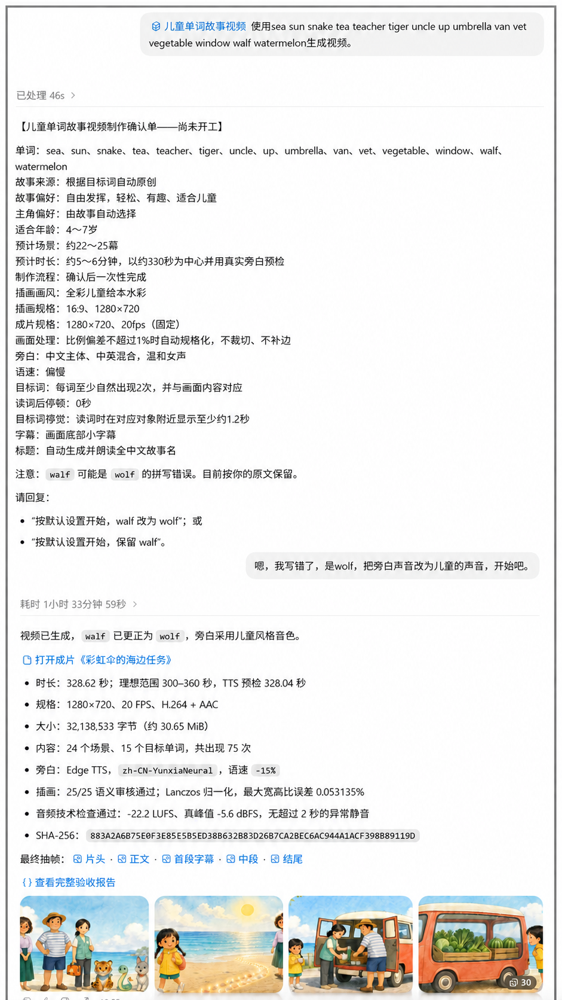
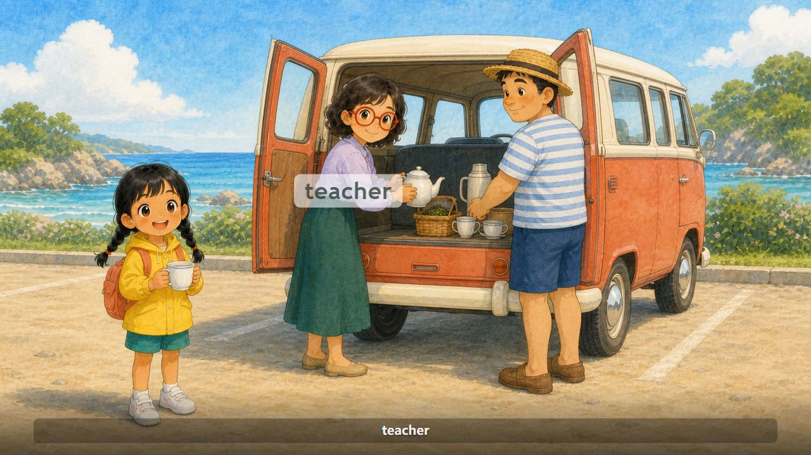

# Kids Word Story Video

<p align="center">
  <a href="#中文"></a>
  &nbsp;&nbsp;
  <a href="#english"></a>
  &nbsp;&nbsp;
  <a href="#examples"></a>
</p>

<p align="center"><strong>将自定义英语单词编成连贯的儿童绘本故事视频，配中英混合语音旁白。</strong><br>Turn custom English words into a coherent children’s picture-book story video with mixed Chinese-English narration.</p>

## 中文

这是一个面向中文用户的 Codex 技能：把数量灵活的英语目标词编入一段连贯、有趣的儿童故事，并制作成完整的 720p 宽屏 MP4 视频。默认故事约 5～6 分钟，以中文为主体，在旁白中自然保留目标英语单词。

### 主要能力

- 先展示确认单，确认目标词和偏好后再开始制作。
- 围绕目标词原创完整故事，默认按剧情安排约 22～25 幕，并用真实 TTS 在批量生图前检查时长。
- 为每个项目建立专属角色和视觉设定，生成稳定的 16:9 儿童绘本插画。
- 对关键动作明确主体、身体部位或工具、作用对象、接触、位置、方向和结果；普通背景与装饰保留创作自由。
- 正式插画默认每批最多并行生成三个独立场景；连续动作、道具继承、前图依赖和重试自动转为串行计划。
- 对插画进行比例检查和语义审核；不符合故事情景时最多额外重试两次，再选择偏差最小的候选图，并只允许轻微调整单幕故事或旁白。
- 默认使用温和中文女声，生成中文主体、中英混合的语音旁白。
- 读词后音频停顿默认是 `0` 秒，可独立配置；目标词从发音开始在对应人物或物体附近显示至少约 1.2 秒，并伴随轻微、舒适的呼吸式强调。
- 自动生成自然完整的全中文故事名并朗读，标题音频结束后保留约 0.6 秒画面。
- 使用 Remotion 输出固定 `1280×720`、`20fps`、H.264 + AAC 的 MP4。
- 保存流程状态、输入指纹和 QA 证据，支持中断恢复；最终渲染至少保留 20 分钟运行上限，并在交付前进行技术验收和主观审查。

### 安装

推荐直接使用 Codex 提供的工作区运行时。手动准备环境时需要 Python 3.10 或更高版本、Node.js 22 或更高版本、pnpm 11、Chrome 或 Edge，并允许 TTS 服务访问网络；FFmpeg 会安装在每个视频项目自己的 Python 虚拟环境中。

#### 方法一：让 Codex 自动安装（推荐）

在 Codex 中直接提出下面的要求：

```text
请从 GitHub 仓库 https://github.com/shxrise/kids-word-story-video 安装这个 Codex 技能。安装完成后检查技能是否能被发现，并告诉我结果。
```

Codex 会下载仓库并把技能安装到正确的技能目录。如果 Codex 请求网络访问或文件写入授权，请按界面提示确认。

#### 方法二：使用 Git 手动安装

将仓库克隆到 Codex 的技能目录：

```powershell
git clone https://github.com/shxrise/kids-word-story-video.git "$env:USERPROFILE\.codex\skills\kids-word-story-video"
```

重新打开 Codex 任务后，该技能即可被自动发现。技能目录名应保持为 `kids-word-story-video`。

### 使用

在 Codex 中直接提出视频需求，例如：

```text
使用 kids-word-story-video，把 apple、ant、book、bird 做成一个儿童单词故事视频。
```

技能会先给出确认单。在你确认之前，它不会创建项目、生成插画、合成语音或渲染视频。确认后，Codex 会按照 `SKILL.md` 中的完整流程执行制作和验收。

### 仓库结构

```text
SKILL.md                    技能入口和核心工作流
agents/openai.yaml          Codex 界面元数据
scripts/                    项目创建、语音、审核、渲染和验收脚本
references/                 故事、确认单和 QA 规则
assets/remotion-template/   可复用的 Remotion 视频项目模板
```

### 说明

- 这是社区创作的个人项目，不是 OpenAI 官方技能。
- 插画生成、语音服务和本地渲染能力取决于当前 Codex 环境及可用工具。
- 请只使用你有权处理和分享的单词、图片、声音及其他素材。

## English

Kids Word Story Video is a Codex skill designed primarily for Chinese-speaking users. It turns a flexible list of English target words into a coherent, playful children’s story and produces a complete 720p widescreen MP4. A default story runs about 5–6 minutes and uses Chinese-led narration with the target English words spoken naturally in context.

### Key features

- Shows a confirmation card before any production work begins.
- Writes an original story around the target words, usually planning about 22–25 story-driven scenes, and checks real TTS duration before bulk illustration.
- Creates a project-specific cast and visual bible for consistent 16:9 children's-book illustrations.
- Describes plot-critical actions with an explicit actor, body part or tool, object, contact, position, direction, and result while leaving ordinary backgrounds flexible.
- Generates up to three independent scene illustrations in parallel by default, with serial planning for continuity, inherited prop state, previous-image dependencies, and retries.
- Checks image aspect ratios and semantics. If an image misses the story context, it allows up to two additional attempts, then selects the closest candidate and permits only a small scene-level narration adjustment.
- Uses a gentle Chinese female voice by default for Chinese-led, mixed Chinese-English narration.
- Keeps post-word audio pauses independently configurable at a default of `0` seconds. Each target label appears near the matching person or object for at least about 1.2 seconds with a gentle breathing emphasis.
- Creates and narrates a natural, complete Chinese story title, then holds the title picture for about 0.6 seconds after the title audio ends.
- Renders a fixed `1280×720`, `20fps`, H.264 + AAC MP4 with Remotion.
- Records pipeline state, input fingerprints, and QA evidence for resumable, verifiable delivery, with at least a 20-minute final-render limit.

### Installation

The Codex workspace runtime is recommended. A manually prepared environment needs Python 3.10+, Node.js 22+, pnpm 11, Chrome or Edge, and network access for TTS. FFmpeg is installed inside each generated video's Python virtual environment.

#### Method 1: Ask Codex to install it (recommended)

Give Codex this request:

```text
Install the Codex skill from https://github.com/shxrise/kids-word-story-video. After installation, verify that Codex can discover the skill and report the result.
```

Codex will download the repository and place the skill in the appropriate skills directory. Approve network or file-write access if Codex asks for it.

#### Method 2: Install manually with Git

Clone the repository into the Codex skills directory:

```powershell
git clone https://github.com/shxrise/kids-word-story-video.git "$env:USERPROFILE\.codex\skills\kids-word-story-video"
```

Start a new Codex task so the skill can be discovered. Keep the folder name as `kids-word-story-video`.

### Usage

Ask Codex for a word-story video, for example:

```text
Use kids-word-story-video to make a children's story video with apple, ant, book, and bird.
```

The skill first presents a confirmation card. It does not create a project, generate illustrations, synthesize speech, or render video until you confirm. After confirmation, Codex follows the complete production and QA workflow in `SKILL.md`.

### Repository layout

```text
SKILL.md                    Skill entry point and core workflow
agents/openai.yaml          Codex UI metadata
scripts/                    Project, speech, review, render, and QA tools
references/                 Story, confirmation, and QA rules
assets/remotion-template/   Reusable Remotion video project template
```

### Notes

- This is a community-built personal project, not an official OpenAI skill.
- Image generation, speech services, and local rendering depend on the tools available in the current Codex environment.
- Only use words, images, voices, and other materials that you are authorized to process and share.

<a id="examples"></a>

## 示例 / Examples

下面展示一次儿童单词故事视频的操作过程，以及成品的前 60 秒剪辑。点击图片可以查看完整尺寸，点击视频封面或播放链接可以直接观看成品片段。

The example below shows the production workflow and the first 60 seconds of the finished video. Select the workflow image to view it at full size, or select the video poster or play link to watch the clip directly.

### 操作过程 / Production workflow

<p align="center">
  <a href="docs/examples/production-workflow.png"></a>
</p>

### 成品片段 / Finished video clip

<p align="center">
  <a href="docs/examples/story-demo-first-60s.mp4?raw=1"></a>
</p>

<p align="center">
  <a href="docs/examples/story-demo-first-60s.mp4?raw=1"><strong>▶ 播放 60 秒成品片段 / Watch the 60-second finished clip</strong></a><br>
  <sub>1280×720 · 20fps · H.264 + AAC</sub>
</p>

## License

MIT License. See [LICENSE](LICENSE).
