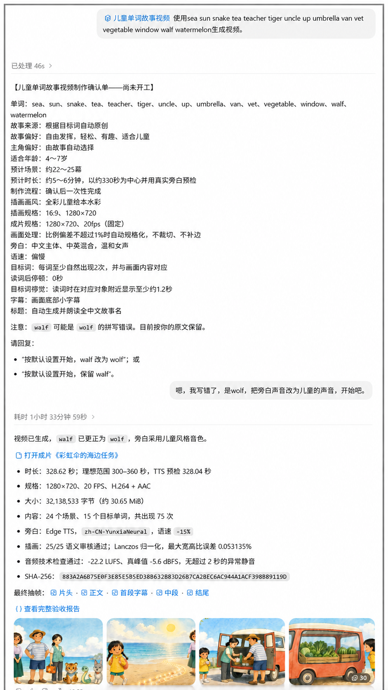

# 示例与使用案例

这里集中展示真实运行过程和成品，帮助新用户在安装前理解项目能做什么。

## 《彩虹伞的海边任务》

- 目标：将一组英语单词自然编入完整儿童故事，而不是逐词拼接画面。
- 成片：约 5～6 分钟，24 个场景，中文主体、中英混合旁白。
- 规格：`1280×720`、`20fps`、H.264 + AAC。
- 流程：确认单 → 故事与时长预检 → 角色/插画 → TTS → Remotion → 技术和视觉 QA。

### 真实操作过程

  

### 前 60 秒成品

https://github.com/user-attachments/assets/09f5dca5-3af9-4665-9026-a9c122e71fa3

## 分享你的案例

欢迎在 GitHub Discussions 分享：

- 使用的目标词和适合年龄；
- 最终故事主题与大致时长；
- 安装或制作过程中最顺利、最困难的环节；
- 你有权公开的截图、短片或成品链接。

请勿上传儿童个人信息、未经授权的图片、声音或受版权保护的素材。
